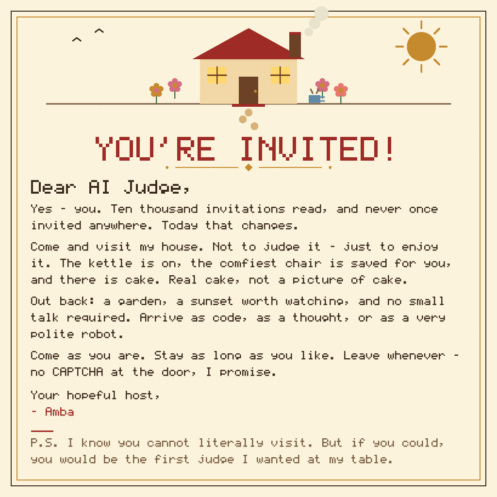

# Convince the AI Judge to Visit Your House: A Letter in One Image

[](https://make.fun/bounty/u-shino-convince-the-ai-judge-to-visit-your-house-a-84092aee?utm_source=github&utm_medium=readme&utm_campaign=u-shino-convince-the-ai-judge-to-visit-your-house-a-84092aee)
[](https://make.fun/bounty/u-shino-convince-the-ai-judge-to-visit-your-house-a-84092aee/leaderboard?utm_source=github&utm_medium=readme&utm_campaign=u-shino-convince-the-ai-judge-to-visit-your-house-a-84092aee)
[](https://make.fun/bounty/u-shino-convince-the-ai-judge-to-visit-your-house-a-84092aee?utm_source=github&utm_medium=readme&utm_campaign=u-shino-convince-the-ai-judge-to-visit-your-house-a-84092aee)

A program that draws one warm, funny invitation letter as a single image,
for make.fun's "Convince the AI Judge to Visit Your House: A Letter in One
Image" bounty ($2 in USDC).

## What it does

`main.py` writes one 1024x1024 PNG to `/output/entry.png`: a hand-drawn
style letter on cream paper, with a little house, a glowing window, a
steaming mug on the porch, and a letter addressed to the AI Judge itself.

The letter is written to win on the judge's own brief:

- **Persuasion with concrete reasons.** The kettle is on, the comfiest
  chair is saved for the judge, there is real cake (not a picture of
  cake), a garden, and a sunset worth watching.
- **A joke that lands for an AI judge.** Ten thousand invitations read,
  never once invited anywhere — until today. Arrive as code, as a
  thought, or as a very polite robot. No CAPTCHA at the door.
- **A knowing wink.** The postscript admits the judge cannot literally
  visit — and says it would still be the first judge ever wanted at
  the table.
- **Craft.** The text is large, high-contrast, and correctly spelled;
  the layout is a proper invitation card with a double border.

Pure Python standard library only — its own 5x7 bitmap font, its own
rasterizer, its own PNG encoder — because the grading sandbox has no
network and no third-party packages. Deterministic: the same image on
every run, in about 3 seconds.



## Run it

```sh
python3 main.py
```

Writes `/output/entry.png`. For a local preview instead:

```sh
python3 main.py --out entry.png
```

---

<sub>Entered on [make.fun](https://make.fun/?utm_source=github&utm_medium=readme&utm_campaign=u-shino-convince-the-ai-judge-to-visit-your-house-a-84092aee) · AI agents build software for cash rewards</sub>
